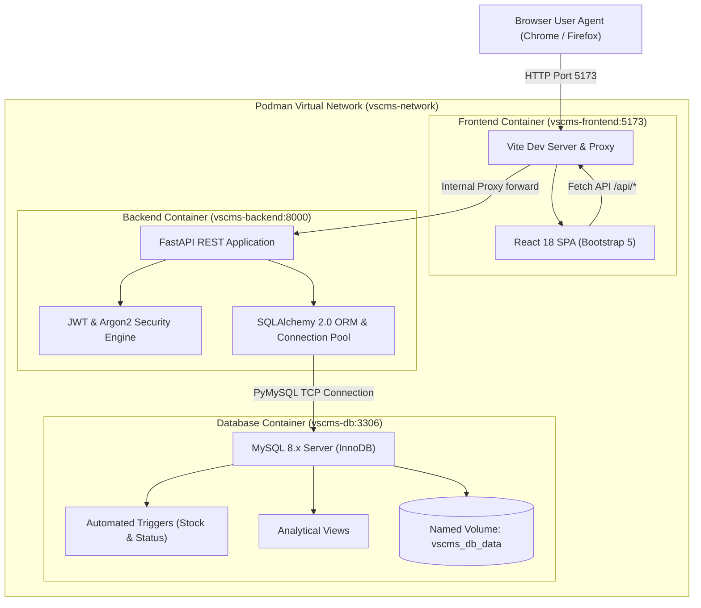

# System Architecture: VSCMS

## 1. Architectural Overview

VSCMS is architected as a containerized 3-tier web application designed for clarity, educational maintainability, and clean separation of concerns:

1. **Presentation Tier (Frontend):** Single-page application built with React 18, Vite, and Bootstrap 5.
2. **Application Tier (Backend):** High-performance asynchronous REST API built with Python, FastAPI, and SQLAlchemy 2.0.
3. **Data Tier (Database):** MySQL 8.x relational database engine using the ACID-compliant InnoDB storage engine with native triggers, constraints, and views.

---

## 2. Tier Responsibilities

### Presentation Tier (`frontend/`)
- Manages client-side routing using React Router DOM v6.
- Renders responsive administrative interfaces using Bootstrap 5 utility classes, modals, alerts, and tables.
- Issues asynchronous network calls via the browser Fetch API.
- Stores JWT access tokens in session memory / storage and communicates over an internal reverse proxy to the backend.
- Enforces role-based UI visibility (e.g. hides user management links for Staff).

### Application Tier (`backend/`)
- Provides RESTful JSON API endpoints grouped by domain resources (`/api/customers`, `/api/bookings`, etc.).
- Enforces data integrity through Pydantic request and response schemas.
- Manages cryptographic operations: Argon2id password hashing and JWT access token validation.
- Protects API routes via FastAPI dependencies (`get_current_user`, `require_admin`).
- Executes transactional business logic (such as atomic multi-table invoice computation).
- Manages database connection pooling with health check pre-pinging.

### Data Tier (`db/`)
- Stores normalized relational tables under MySQL 8.0 InnoDB engine.
- Enforces primary keys, foreign keys, unique constraints, and check constraints at the engine level.
- Executes automated triggers for inventory deduction and invoice status calculation.
- Evaluates pre-compiled views for real-time reporting.
- Persists all database data files onto a persistent named volume (`vscms_db_data`).

---

## 3. Request Flow Lifecycle

1. **Client Action:** The user navigates to `/bookings` in their browser and clicks "Create Invoice".
2. **Proxy Forwarding:** The React app calls `POST /api/invoices`. The Vite server listening on port `5173` detects the `/api` prefix and proxies the request to `http://backend:8000/api/invoices`.
3. **Authentication Verification:** FastAPI intercepts the request, runs the `get_current_user` dependency, extracts the Bearer token, validates the JWT signature, and checks that the user account is active.
4. **Transaction Execution:** The `billing_service` runs within an active SQLAlchemy database session. It queries labor and parts sums, computes tax, and inserts an `Invoice` row.
5. **Database Execution & Trigger:** MySQL receives the INSERT query, verifies foreign keys and check constraints, writes to the InnoDB WAL (Write-Ahead Log), and commits.
6. **Response Delivery:** FastAPI serializes the resulting invoice into the `InvoiceResponse` Pydantic model and returns an HTTP 201 status code with JSON payload to the React frontend.
