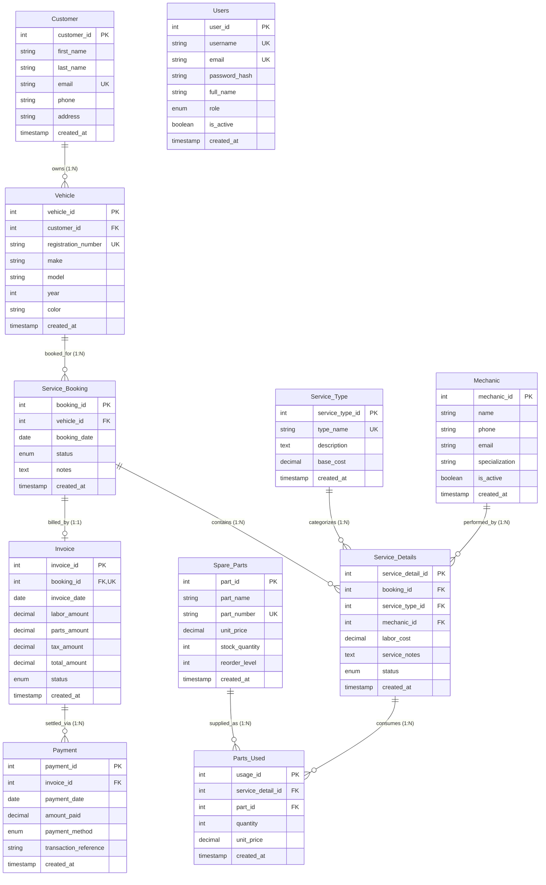

# Entity-Relationship (ER) Diagram: VSCMS

## 1. Complete Mermaid ER Diagram

---

## 2. Cardinality & Relationship Breakdown

### 2.1 One-to-Many Relationships (1:N)
- **`Customer (1)` to `Vehicle (N)`:** Each customer may register zero, one, or multiple vehicles. Each vehicle record strictly references one owner (`Vehicle.customer_id`).
- **`Vehicle (1)` to `Service_Booking (N)`:** A vehicle can have multiple service visit bookings over time.
- **`Service_Booking (1)` to `Service_Details (N)`:** A booking appointment can comprise multiple distinct repair/maintenance tasks.
- **`Service_Type (1)` to `Service_Details (N)`:** A catalog service package (e.g., Brake Overhaul) can be assigned to multiple work order tasks.
- **`Mechanic (1)` to `Service_Details (N)`:** A mechanic is assigned to multiple repair jobs across appointments.
- **`Invoice (1)` to `Payment (N)`:** An invoice can receive multiple installment payments over time until the balance is fully settled.

### 2.2 Many-to-Many Relationship (M:N via Junction Table)
- **`Service_Details` to `Spare_Parts` via `Parts_Used`:**
  - One service line item may require multiple parts (e.g. 4 liters of Engine Oil + 1 Oil Filter).
  - One spare part catalog item is installed in multiple service operations.
  - The junction table `Parts_Used` resolves this M:N relationship into two 1:N relationships (`Service_Details (1)` -> `Parts_Used (N)` and `Spare_Parts (1)` -> `Parts_Used (N)`), additionally recording the installed `quantity` and snapshotting the `unit_price`.

### 2.3 One-to-One Relationship (1:1)
- **`Service_Booking` to `Invoice`:**
  - An invoice is created for exactly one service booking.
  - Enforced by the `UNIQUE` constraint on `Invoice.booking_id`.
  - Cardinality is `0..1` to `1` because newly booked services do not have an invoice until repairs are completed and billed.
